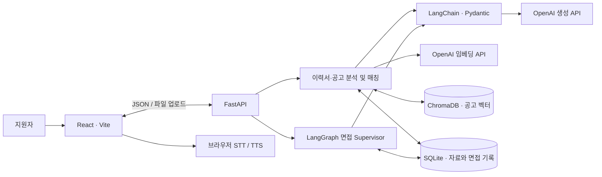

# AI Talent Matcher Pro

지원자의 이력서와 채용 공고를 비교하고, 실제 지원 기업과 직무에 맞춰 다중 AI 면접관과 연습할 수 있는 AI 기반 취업 준비 솔루션입니다. 저장한 공고, 지원자 자료, 면접 결과를 다음 연습에 재사용하는 로컬 PoC입니다.

## 주요 기능

- **이력서 분석과 공고 추천** — PDF에서 기술·경력·프로젝트를 추출합니다. 잡코리아·사람인 수집 공고와 기본 예시 공고를 탐색하고, 벡터 유사도로 공고를 추천합니다. 지정 공고 매칭에는 의미 유사도와 LLM 평가를 함께 사용합니다.
- **공고 등록과 직무 비교** — 공개 URL, 붙여넣은 텍스트, TXT·PDF·PNG·JPG 파일로 공고를 분석하고 저장합니다. 필수·우대 요구사항별로 이력서의 확인 가능한 근거, 보완점, 면접 확인 질문을 제공합니다.
- **개인 맞춤형 면접** — 이력서·포트폴리오 PDF 여러 개와 추가 메모를 선택하고, 기업·직무·난이도·면접관·질문 수 및 공고와 지원자 자료의 질문 비중을 설정합니다.
- **다중 AI 면접관** — 인사 담당자·실무 팀장·기술 담당자·임원 중 선택한 역할로 연습합니다. LangGraph Supervisor가 답변 평가에 따라 꼬리 질문과 면접관 전환, 종료를 결정합니다.
- **피드백·재연습·성장 분석** — 종합 평가와 문항별 답변·피드백, 질문 출제 근거를 조회합니다. 기록에서 면접을 재개하거나 특정 질문을 다시 연습할 수 있습니다. 성장·훈련 화면은 저장된 면접 점수 추이와 평가 영역, 보완점, 연습 질문을 보여줍니다.
- **음성 및 텍스트 면접** — 지원 브라우저에서 Web Speech API로 질문을 읽어주고 발화를 텍스트로 변환합니다. 답변 텍스트를 수정한 뒤 제출할 수 있습니다.

## 기술 스택

| 영역 | 구성 |
| --- | --- |
| 프런트엔드 | React 18, Vite 5, Tailwind CSS, Axios, Lucide |
| 백엔드·문서 처리 | Python, FastAPI, Pydantic, pdfplumber, PyPDF2, httpx |
| AI·에이전트 | OpenAI API, LangChain, langchain-openai, LangGraph |
| 저장·검색 | SQLite, ChromaDB, `text-embedding-3-small` |
| STT/TTS | 브라우저 Web Speech API |
| 검증 | Pytest, Python compileall, Vite 빌드, 실제 브라우저 레이아웃 측정 |

## 시스템 아키텍처



직접 저장한 공고와 지원자 분석 자료, 면접 세션·답변·평가는 SQLite에 보관합니다. 기본 예시 공고와 수집 공고의 실행 중 목록은 메모리에서 관리하고, 검색 벡터는 임베딩 모델별 Chroma 컬렉션에 저장합니다.

## AI 면접 워크플로

1. 이력서와 공고를 분석하고, 구조화된 공고 요구사항을 지원자 경험과 비교합니다. 저장 자료를 불러오거나 면접 준비 화면에서 새 자료를 입력할 수 있습니다.
2. 참여 역할과 질문 기준을 설정합니다. 이전 면접 반영을 선택하면 같은 기업 또는 유사한 직무에서 반복된 보완점이 질문의 참고 자료가 됩니다.
3. Supervisor가 면접관을 선택하고 해당 역할이 질문을 생성합니다. 질문에는 공고 요구사항이나 지원자 자료 등 출제 근거를 기록할 수 있습니다.
4. 답변을 구조화해 평가합니다. Supervisor는 꼬리 질문을 이어가거나 다음 면접관을 선택합니다. 질문 한도에 도달하거나 사용자가 종료하면 종합 평가로 넘어갑니다.
5. SQLite에 진행 상태와 결과를 저장합니다. 면접 기록에서는 결과 확인과 재연습, 성장·훈련 화면에서는 누적 평가 확인이 가능합니다.

## 차별화 요소

질문이 실제 공고 요건과 지원자 경험을 연결하고, 역할별 면접관이 저장된 세션 상태에 따라 진행합니다. 질문·답변·평가를 구조화해 다음 연습에서 다시 활용할 수 있습니다. 동일 자료 분석과 동일 공고·이력서 비교 결과를 캐시하고, 공고 벡터는 내용이 바뀔 때 갱신합니다. 질문 수와 꼬리 질문 횟수에도 상한을 둡니다.

## 로컬 실행 · Windows PowerShell

Python 3.11, Node.js 22와 npm으로 검증했습니다. OpenAI API 키와 네트워크 연결이 필요하며, 생성 및 임베딩 호출에 **OpenAI API 사용료가 별도로 발생**합니다.

저장소 루트에서 백엔드를 설정합니다.

```powershell
cd backend
py -3.11 -m venv venv
.\venv\Scripts\Activate.ps1
python -m pip install -r requirements.txt
if (!(Test-Path .env)) { Copy-Item ..\.env.example .env }
notepad .env
```

`backend/.env`에 다음 항목을 설정합니다. 키는 이 로컬 파일에만 보관합니다.

```dotenv
OPENAI_API_KEY=
OPENAI_MODEL=gpt-6.1-terra
OPENAI_EMBEDDING_MODEL=text-embedding-3-small
CHROMA_PERSIST_DIR=./chroma_db
```

```powershell
python -m uvicorn app.main:app --reload --host 127.0.0.1 --port 8000
```

새 터미널에서 저장소 루트를 기준으로 프런트엔드를 실행합니다.

```powershell
cd frontend
npm ci
npm run dev -- --host 127.0.0.1
```

- [앱](http://127.0.0.1:5173/)
- [FastAPI 문서](http://127.0.0.1:8000/docs)

## 테스트 및 검증

**이전 기능 검증**에서는 백엔드 자동화 테스트 22개가 통과했습니다. 가상 자료로 실제 OpenAI 생성·임베딩 호출, 이력서 분석, 공고 매칭, LangGraph 꼬리 질문, 종합 평가 및 SQLite 저장을 확인했습니다. React 빌드와 1920×1080, 1366×768, 800×900 브라우저 레이아웃도 확인했습니다.

**이번 GitHub 반영 검증**에서는 백엔드 자동화 테스트 22개가 통과했고 실패는 0개였습니다. Python 컴파일 검사와 Vite 프로덕션 빌드도 통과했습니다. Git diff와 업로드 대상 파일을 검사했습니다. 백엔드 테스트는 가상환경에서 `python -m pip install pytest` 후 `python -m pytest -q`로 실행할 수 있습니다. 컴파일은 백엔드에서 `python -m compileall -q app tests`, 빌드는 프런트엔드에서 `npm run build`를 실행합니다.

## 현재 제한 및 향후 개선

- 지원자 발언 의도 분석과 실제 면접에 가까운 대화 흐름을 개선합니다.
- 질문 의미 확인이나 재설명 요청을 받았을 때 기존 질문을 유지하도록 개선합니다.
- 면접관별 질문 기회의 균형, API 호출 수, 응답 속도를 개선합니다.
- 실제 마이크 음성 인식과 스피커 재생은 아직 검증하지 않았습니다.
- 공고 URL 분석은 접근 가능한 공개 페이지에 의존합니다. 로그인 또는 동적 렌더링이 필요한 공고는 텍스트나 파일로 등록할 수 있습니다.

## 추가 문서

- [아키텍처와 매칭 흐름](docs/architecture/README.md)
- [개발 및 API 경로](docs/development/README.md)
- [로컬 운영과 데이터 처리](docs/operations/README.md)
- [향후 개선 방향](docs/roadmap/README.md)
